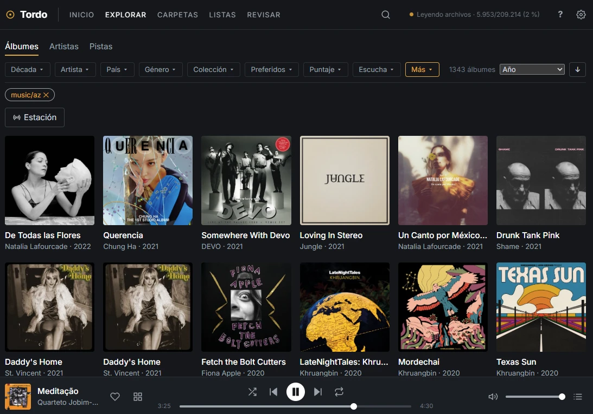
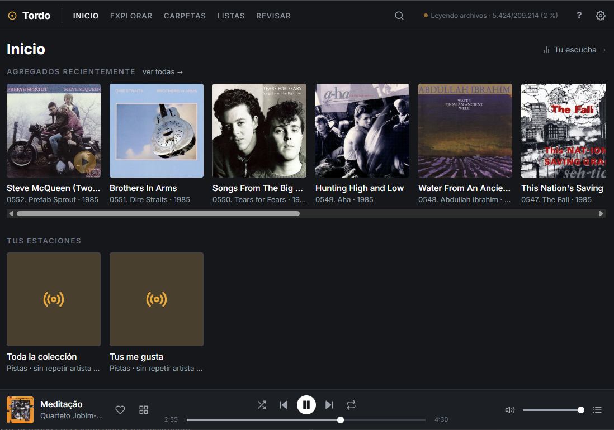
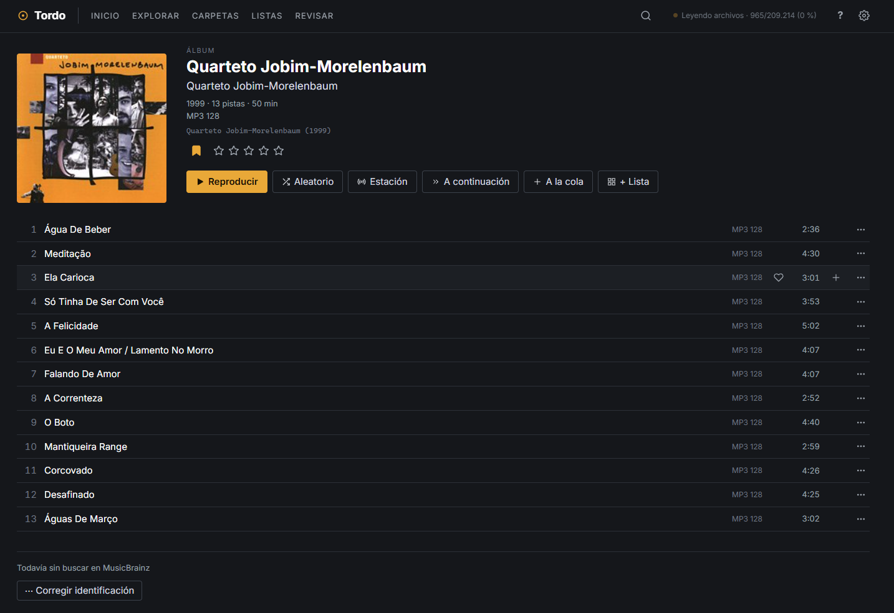
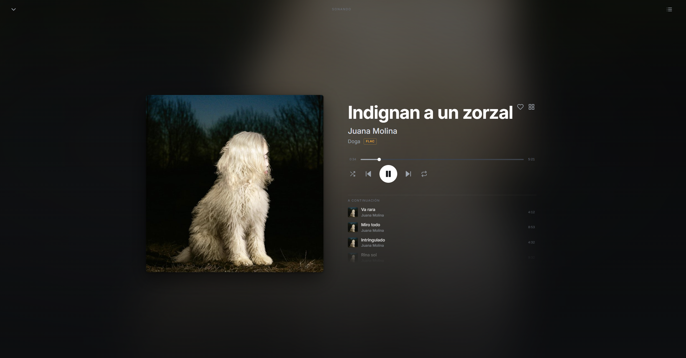
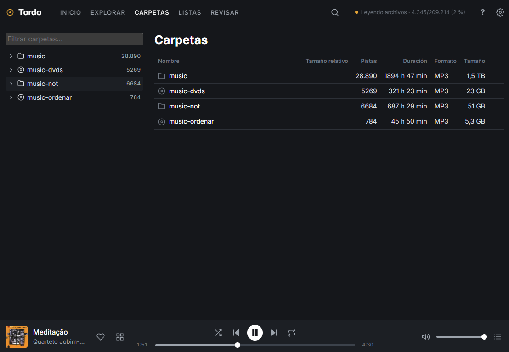

# Tordo

[English](README.md) · Español · [Português](README.pt-BR.md)

**Tu colección de música, ordenada y para escuchar desde cualquier navegador de tu casa.**
Indicale a Tordo las carpetas donde está tu música: cataloga cada álbum, lo reconoce en
internet y te deja recorrerla y escucharla desde la computadora, el teléfono o la tablet.

- **Tus archivos quedan como están.** Tordo solo lee tu música: nunca mueve, renombra,
  retaguea ni borra nada.
- **Un solo archivo, nada que instalar.** Tordo guarda su catálogo en su propia carpeta, así
  que podés llevarlo en un disco a otra computadora.
- **Privado.** Corre en tu computadora y en la red de tu casa, sin cuentas y sin nube.

## Para empezar

1. **Descargá** el archivo para tu computadora desde la
   [última versión](https://github.com/martjanz/tordo/releases/latest):
   **Windows** `tordo-windows.exe` · **Mac** `tordo-macos.zip` · **Linux**
   `tordo-linux-amd64.zip` (`tordo-linux-arm64.zip` en una Raspberry Pi).
2. **Poné Tordo al lado de tus carpetas de música** (en el mismo disco, si tu música está en
   un disco externo):
   - **Mac y Linux:** hacé doble clic en el zip para obtener una carpeta `tordo`, y mové esa
     carpeta.
   - **Windows:** creá una carpeta llamada `tordo` y mové ahí el archivo descargado.
3. **Hacé doble clic en el archivo `tordo` de esa carpeta.** Tordo se abre en el navegador.
   La primera vez, la computadora puede pedirte permiso para abrirlo: mirá
   [Si tu computadora no lo deja abrir](#si-tu-computadora-no-lo-deja-abrir).
4. **Elegí tus carpetas de música** y hacé clic en **Empezar**. Los álbumes aparecen a medida
   que Tordo los lee.

Eso es todo. La próxima vez, hacé doble clic en el archivo de nuevo. Mientras Tordo está
abierto queda una ventanita con texto; cerrala para cerrar Tordo.

Para escuchar desde el teléfono, abrí **Ajustes → Red local** en la computadora. Para
cualquier otra duda, apretá **?** en Tordo.

### Si tu computadora no lo deja abrir

Tordo no se distribuye por una tienda de aplicaciones, así que la primera vez hace falta un
paso más:

- **Windows:** cuando aparezca *Windows protegió su PC*, hacé clic en **Más información** y
  después en **Ejecutar de todas formas**.
- **Mac:** cuando la Mac diga que no puede verificar Tordo, hacé clic en **OK**, abrí
  **Configuración del Sistema → Privacidad y seguridad**, bajá hasta el final, hacé clic en
  **Abrir igualmente** y volvé a hacer doble clic en el archivo.
- **Linux:** si el doble clic abre el archivo en un editor de texto, hacé clic derecho y
  elegí **Ejecutar como un programa** (o **Ejecutar**).

## Qué podés hacer

- **Recorrer** por álbum, artista, pista o carpeta, con filtros por década, país, género,
  estilo, formato, calidad y más. La búsqueda encuentra lo que sea mientras escribís
  (Ctrl+K o ⌘K).
- **Tener los datos correctos:** los álbumes se reconocen en [MusicBrainz](https://musicbrainz.org)
  (y, si querés, en [Discogs](https://www.discogs.com)) para tener títulos, años, países,
  géneros y tapas correctos, sin tocar tus archivos.
- **Escuchar** álbumes, carpetas y listas, en aleatorio, o arrancar una **estación** sin fin a
  partir de un artista, un género, una carpeta o tus favoritos.
- **Marcar** canciones con ♥, guardar álbumes para volver a ellos y puntuar con ★.
- **Escuchar a un volumen parejo** entre álbumes (normalización de volumen).
- **Ver tu historial de escucha:** las canciones, álbumes, artistas y géneros más escuchados.
- **Ordenar:** encontrar duplicados y archivos en formatos que el navegador no reproduce.
  Tordo solo los muestra, nunca borra.
- **Escuchar desde cualquier dispositivo** de la red de tu casa, protegido con un PIN.
- **Rockola:** que suene en los parlantes de la computadora y que todos agreguen canciones
  desde sus teléfonos.
- **En tu idioma:** español, inglés o portugués de Brasil.

<table>
  <tr>
    <td width="50%"> <b>Inicio</b>: álbumes agregados recientemente y tus estaciones</td>
    <td width="50%"> <b>Álbum</b>: pistas, formato, puntaje, reproducir, aleatorio, estación, cola y lista</td>
  </tr>
  <tr>
    <td width="50%"> <b>Sonando</b>: el reproductor a pantalla completa</td>
    <td width="50%"> <b>Carpetas</b>: tus carpetas con cantidad de pistas, duración, formato y tamaño</td>
  </tr>
</table>

## Bueno saber

- **El primer escaneo lleva un rato.** Leer una colección grande lleva minutos, y
  reconocerla en internet, más: unas cuantas horas para 10.000 álbumes la primera vez.
  Mientras tanto podés escuchar, y si cerrás Tordo sigue donde quedó.
- **Funciona sin internet.** Solo el reconocimiento en línea lo necesita; espera y reintenta
  solo.
- **Extras opcionales:**
  - [ffmpeg](https://ffmpeg.org/download.html) le permite a Tordo reproducir archivos WMA,
    ALAC, AIFF, APE y WavPack, y emparejar el volumen de canciones sin tags ReplayGain.
  - Un [token de Discogs](https://www.discogs.com/settings/developers) gratuito, pegado en
    Ajustes, da géneros y estilos más precisos.
- **Solo en la red de tu casa.** El acceso desde otros dispositivos es HTTP sin cifrar: está
  bien en casa, no para internet.
- **Los ajustes se cambian en la computadora que corre Tordo**, no desde otros dispositivos.

## Para usuarios avanzados

La configuración (`config.json`), las opciones de línea de comandos, el detalle de cada
función, cómo funcionan el escaneo y la identificación, la API HTTP y cómo compilar Tordo
están en la [versión en inglés](README.md#for-advanced-users) y en
[docs/](docs/how-it-works.md) (en inglés). El
[diseño](docs/superpowers/specs/2026-10-01-tordo-design.md) está en español.
