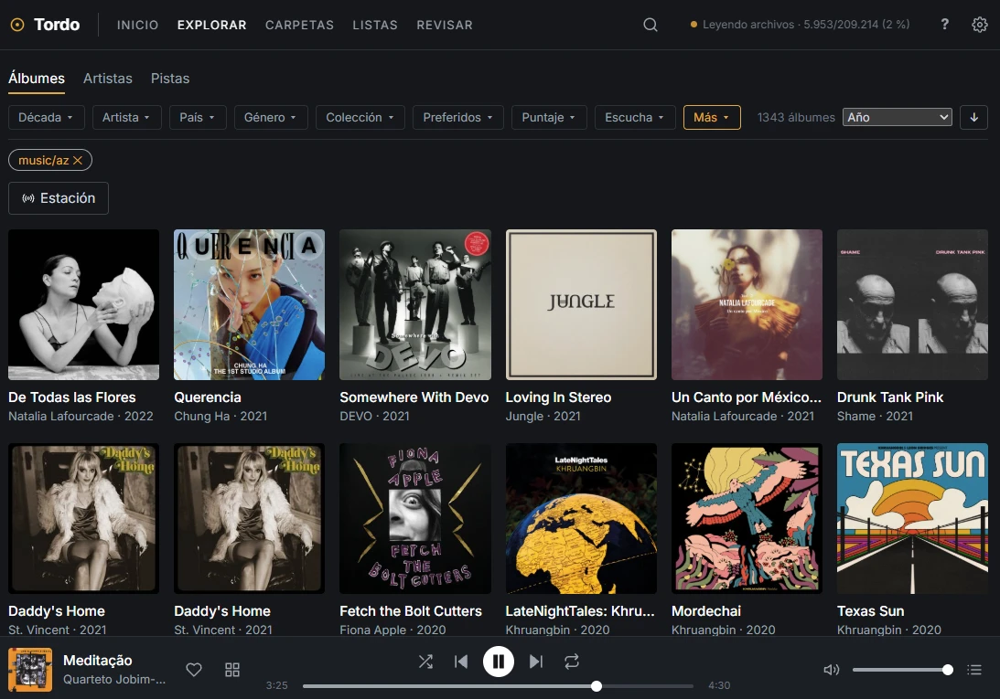
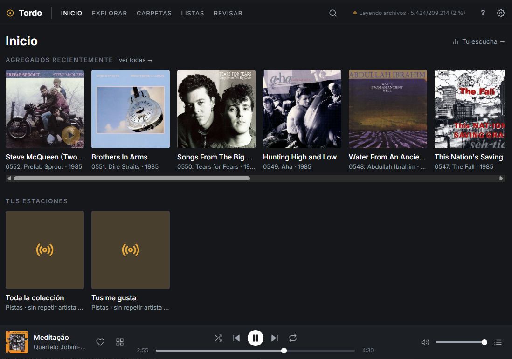
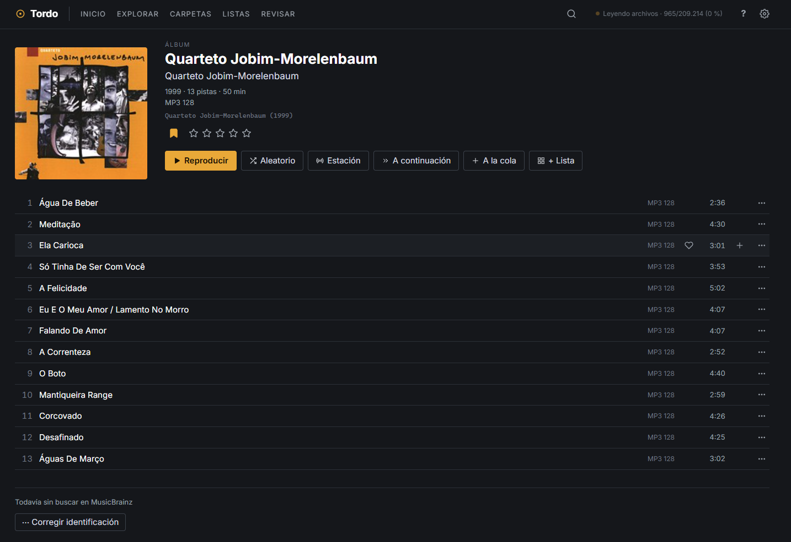
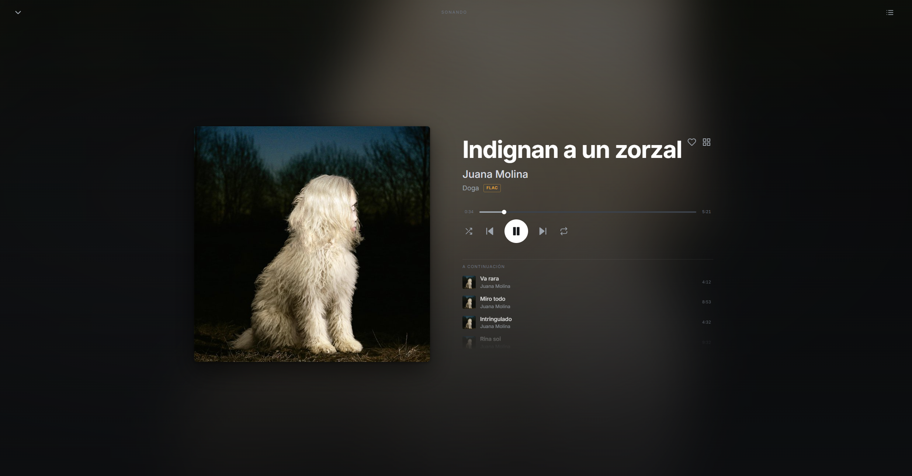
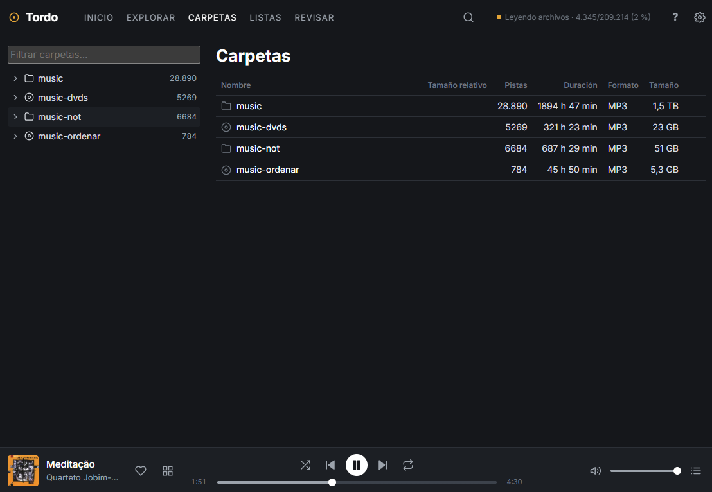
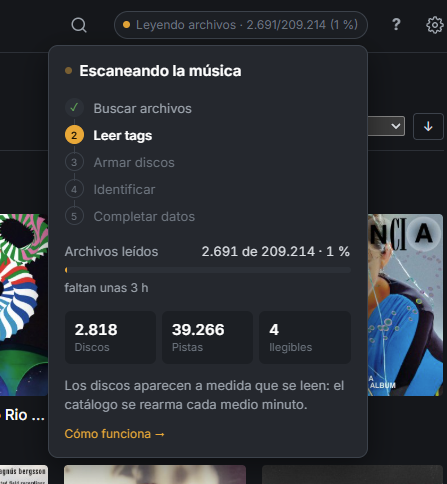

# Tordo

English · [Español](README.es.md) · [Português](README.pt-BR.md)

A local, portable catalog and player for a music collection spread over a few
folders of one drive. **Status: M6 (Jukebox mode: use the computer as a speaker)** — scanning,
native tag reading, audio fingerprints, albums, folders and collections, automatic
MusicBrainz and Discogs identification, a localhost JSON API, and the web interface
with the player, likes, ratings, playlists, play counts, stations, Home, listening
statistics, loudness normalization, duplicate detection, network access with PIN, and Jukebox mode
for sharing playback across devices, in three languages (Spanish, English and Brazilian
Portuguese); see `docs/superpowers/specs/2026-10-01-tordo-design.md`.

- **Read-only** on your music: it never moves, renames, re-tags or deletes files.
- **Portable:** one executable per OS; the catalog (`tordo.db`) and
  `config.json` live next to it, with paths relative to it.
- **Local or LAN:** runs on `127.0.0.1` by default; optionally listens on the home network (`0.0.0.0`) with PIN authentication.

## Screenshots

The screenshots show the Spanish interface.



<table>
  <tr>
    <td width="50%"><br><sub><b>Home</b>: recently added albums and your stations</sub></td>
    <td width="50%"><br><sub><b>Album</b>: tracks, format, rating, play, shuffle, station, queue and playlist</sub></td>
  </tr>
  <tr>
    <td width="50%"><br><sub><b>Now playing</b>: the full-screen player</sub></td>
    <td width="50%"><br><sub><b>Folders</b>: browse the folders with track counts, duration, format and size</sub></td>
  </tr>
  <tr>
    <td width="50%"><br><sub><b>Scan status</b>: each step, progress and time left; albums show up while reading</sub></td>
    <td width="50%"></td>
  </tr>
</table>

## Use

Put the `tordo/` folder on the drive, next to your music folders, and run the
binary for your system. The first run opens Welcome (the assistant) in the
browser, asking for the music folders (`-no-browser` to skip that; the address
is in the log). Choose the folders, an optional Discogs token and normalization,
then save to create `config.json` and scan the library. An existing `config.json`
never shows the assistant. Browse-only mode (read-only folders or `tordo`
binary without write access) shows a settings page instead.

```json
{
  "roots": ["../musica", "../musica-ordenar"],
  "ignore": ["Podcasts", "Soulseek/incomplete"],
  "discogsToken": "",
  "normalize": true,
  "listenMode": false,
  "language": "",
  "rescanMinutes": 60,
  "lan": {
    "enabled": false,
    "port": 4747,
    "pinHash": ""
  }
}
```

`listenMode` (default `false`) is listen mode: the server answers 403 on the
curation routes (scan, identification, collections, genre aliases); it is turned
on in Settings, from the computer that runs Tordo only.

`language` selects the interface language: `""` (default) is automatic and follows the
browser's language, or one of `"es"`, `"en"` and `"pt-BR"`. When the browser's language is
not one of those, the interface is in English. Choosing a language in Settings (from the
computer running Tordo only) applies to every browser that uses this installation.

`rescanMinutes` (default `60`) is how often the folders are checked for changes; `0`
turns it off. The maximum is 10080 (a week).

`discogsToken` is optional; without it genres come from MusicBrainz, from its
links to Discogs and from the tags; get one at https://www.discogs.com/settings/developers.

`normalize` (true when absent) toggles loudness normalization; changes take effect
immediately in Settings without restarting.

`ignore` adds folders to skip: a name matches anywhere, a path with `/` matches
from the root. Other apps' folders (Ableton, djay, Audio Music Apps,
Soulseek's `downloading`, Apple Music libraries) are always skipped.
`ffprobe`, when on the `PATH`, reads the formats the built-in readers don't
(APE, WavPack, raw AAC…).

### Settings

The settings page lets you manage the music roots, ignore patterns, how often to look
for changes, Discogs token, loudness normalization, the interface language, and local network access. Each setting shows what it does
when changed: scanning the library (roots or ignore patterns changed), updating
genres (new Discogs token), or taking effect immediately (normalization).

The **Discogs token** field verifies the token with Discogs's `/oauth/identity`
endpoint once you click "Verify"; the server accepts it anyway if verification
fails (no network). Changing the token triggers an identification update.

**Loudness normalization** can be toggled live without restarting Tordo; the
player and Explore filters update immediately.

Settings can only be changed from the computer running Tordo. From other devices
on the local network, a message shows "Settings can only be changed on the computer
running Tordo", and you can only sign out of your session.

### Browsing and listening

Explore lists albums, artists or tracks of the whole catalog, filtered by
decade and year, artist, country, genre and style, collection, folder,
quality, format and state (unidentified, not playable, with duplicates); it also
filters by Liked (♥; labelled Preferred on the Albums tab, where it filters by the bookmark),
Rating (★ N or more) and Listened (never played, or not played in a year), and orders by
Most played. The filters live in the URL. Artist pages show their albums by year and their
tracks on compilations. The search (Ctrl+K / ⌘K) finds artists, albums, tracks and
folders while typing, ignoring case and accents. Folders is a file explorer:
a folder tree on the left (folders holding only one folder are merged into one
row, `Soulseek › complete`; filter it by name, or press `/`, and move with the
arrow keys and Enter) and, on the right, the folder's subfolders with their
relative size and the files directly in it, sortable by column. On a phone it
becomes one list per folder. A folder wrongly detected as a collection can be
told "It is not a collection". Open an album
and play it, shuffle a folder, queue tracks. The queue
and the volume are kept in the browser, per device. MP3, FLAC, AAC, Opus,
Vorbis and WAV play as they are, with seeking; WMA, ALAC, AIFF, APE and
WavPack need `ffmpeg` on the `PATH` and are converted on the fly (lossless to
FLAC, lossy to MP3), without seeking. Covers come from the album folder's
image, the files' embedded pictures or the Cover Art Archive; thumbnails are
cached in `cache/thumbs/`.

#### Jukebox

Use the computer running Tordo as a speaker from your phone or another browser: open
Settings → Playback on the computer and turn on "Use this computer's audio for Tordo"
(this option appears on the computer only). The top bar shows "🔊 This computer's audio"
while that tab has audio. Keep this tab open; when you reload it, click "Turn audio back on"
once (browsers block sound until the page is clicked). The audio setting is remembered
per tab: when that tab reloads, it reconnects and asks for one click; if another tab
takes over, the first shows "Another browser took over this computer's audio."

From a phone or another browser with LAN access, the top bar shows a "🎵 Jukebox" button
(visible only while the computer's audio is on). Tap it to switch the player to the
computer: the bar shows "Jukebox · on the computer" with the computer's track, queue and
controls; your phone's playback pauses and its queue is kept for later. Not remembered
across reloads.

**Hosts and guests:** The computer running Tordo is always
a host. Other LAN devices are guests by default, but can be marked as
hosts in Settings → Local network → Devices. Hosts have full control: ▶
replaces the queue, skip, seek, volume, shuffle/repeat, reorder, clear, and stations.
Guests can only add: ▶ adds to the end of the queue and starts playback only when
the queue is empty or finished; tapping a single song adds just that song; ⤮ adds the tracks shuffled;
"To queue" and "Play next" work as usual. Guests can pause/resume and remove only the tracks
they added. These limits are enforced by the server.

#### Likes and ratings

Mark tracks, artists and collections with ♥ (Liked; liked tracks are the
*Favorite songs*). Mark albums with the bookmark (*Preferred*): albums are a shortlist to
come back to, not favourites. Preferred albums are stored as album marks (`kind: album`
in the API). Rate tracks and
albums with ★ (1–5 stars). These marks are shown on track rows (alongside a menu
with rating, "Play next", "To queue", and "Add to a list…"), album
page headers, artist pages, the player bar, collection cards and folder pages.
They are saved per audio fingerprint, so they follow files that move, rename or
get re-tagged.

#### Play counts

A play is counted once per pass when you listen to at least 4 minutes or half the
track, whichever is less. Seeking does not add listening time. Play
counts are recorded with the device name; browse them in Explore.

#### Playlists

Create a playlist from the Lists page or with "+ List" on any album, folder,
artist, collection, or from a track's ⋯ menu. Reorder entries by dragging the
handle (mouse or touch) or Alt+↑/↓. Rename, delete the list, or remove individual
entries; tracks whose files went missing stay listed as "unavailable" and are
skipped when playing. Max 5000 entries per playlist.

#### Lists page

View your playlists and curation: Playlists, Favorite songs (♥ tracks, an
automatic playlist), Preferred albums (bookmarked albums, most recently marked first),
your Liked items (Artists · Collections), and your Collections.

#### Stations

A station plays a sequence of albums or tracks drawn from a source, never repeating
what it just queued, with rules for variety and avoiding recently-heard music. Its
source is one of:
- An **Explore query** with two views: `tracks` (the matching tracks), or `albums`
  (every track of the matching albums; maps to Explore's Artists tab for artists).
- A **folder** (recursive; collections are folders too).
- A **playlist** (the entries that can still play).
- **Liked** (♥): all liked tracks, all tracks of liked albums, all tracks of
  liked artists, and all tracks of liked collections (a bookmarked Preferred album counts like a
  liked album).

**Modes** are `tracks` (track by track) or `albums` (whole albums at a time; a single
track counts as an album of one).

**Rules** (with defaults):
- `artistGap` (0–20, default 3): no artist again within the last N tracks.
- `avoidDays` (0–365, default 7): skip tracks played in the last N days (an album:
  any of its tracks).
- The station never repeats a track it already queued (the browser sends up to the
  last 100 played).

When no track fits all rules, they **relax one at a time** in this order: artist gap,
avoid days, already queued (but never the one that just played, if there is another).
The batch is empty (and the station stops) only when the source has nothing playable;
otherwise, relaxed rules allow tracks to repeat.

The browser pulls up to 10 tracks at a time and asks for more when fewer than 3
remain. The queue keeps only the last 100 played tracks, so the station never runs
out. Saved stations are stored by name and live in Your stations on Home.

**Weights** (for drawing tracks):
- Base: 1.
- ×3 when the track or its album is ♥.
- ×2 when its artist is ♥.
- × {1: 0.25, 2: 0.5, 3: 1, 4: 2, 5: 3} by the highest of the track's and album's rating (★).

#### Home

The first page, showing:
- Fixed rows: **Recently added** (newest albums), **Your stations** (saved
  stations, plus two built-ins: "The whole collection" and "Your likes" when something
  is liked), **Keep listening** (albums by their latest play), **Your favorite songs**
  (albums holding ♥ tracks, by the latest liked) and **Preferred albums**
  (bookmarked albums, most recent first).
- **Three rotating rows**, drawn with a seed from the catalog's facets (decade,
  country, genre, style, collections, never-played albums, unheard-in-a-year albums,
  random albums). Most rows need at least 4 albums to be drawn; the random albums row
  needs only 1. Rows with insufficient items are hidden.

The ↻ button draws a new seed and redraws the rotating rows; a new visit draws a new
seed. Only reloads after a scan or identification keep the same seed. Each row links
to Explore with its filter and (except fixed non-curated rows) an ▶ button to start
its station.

#### Listening history (statistics)

Your listening history by period: **Last week** (7 days), **Last month** (30 days), **Last year**
(365 days), **All time**. Rankings of most-played tracks, albums, artists,
countries, and genres; totals (plays, time listened, distinct tracks); and
catalog-wide counts of never-played and unheard-in-a-year **albums** (linked to
Explore).

A play is attributed to **one** track: the file it was played from when present
with the same audio, else the lowest-numbered present file with that audio. Each of
an album's genres counts as one play.

#### Listened facet

Filter albums or tracks by `listened`: **never** (never played) or **year-ago**
(played, but the last play is more than 365 days old). Albums are never-played only
if none of their tracks have been played.

#### Artist pages

Show the artist's 5 most-played tracks (all time) above their albums.

URLs, query parameters, facet names and API paths are in English whatever the interface
language (`/explore`, `/folders`, `/settings`, `/help`…; `?view=albums&order=year`,
`decade`, `listened=never`…).

| Method and path | What it returns |
|---|---|
| `GET /api/status` | scan progress, catalog counts (the last known ones when the catalog is busy; none before the first), `preparing` while the first catalog is built, normalization status, `setupPending` flag, `language` |
| `POST /api/scan` | starts a scan (`Content-Type: application/json`) |
| `GET /api/albums?folder=` | albums, all or inside a folder |
| `GET /api/albums/{id}` | an album with its tracks (with `sizeBytes` per track), versions (other albums sharing duplicate groups), and technical data |
| `GET /api/folders?path=` | a folder: subfolders (with size), albums, loose tracks and the files directly in it (no `path`: the roots) |
| `GET /api/folders/tree?path=` | one level of the Folders tree: subfolders, pass-through chains merged |
| `GET /api/folders/tree/search?q=` | folders by name, with the tree rows leading to them |
| `GET /api/collections` | folders detected as collections, with their albums in order |
| `PUT /api/folders/collection` | `{"path", "collection": false}`: not a collection (`true` takes it back) |
| `GET /api/explore?view=&<facets>&order=&dir=&from=&limit=` | a page of Explore (albums, artists or tracks) with the facets' counts |
| `GET /api/artists/{key}` | an artist: albums by year, appearances on others' albums, and their 5 most-played tracks in `top` |
| `GET /api/search?q=&limit=` | artists, albums, tracks and folders matching `q` |
| `GET /api/genres` | the taxonomy of genres and styles |
| `GET /api/genres/unmapped` | raw tag genres no mapping knows (Genres to map) |
| `PUT /api/genres/aliases`, `DELETE /api/genres/aliases?raw=` | map a raw genre (or ignore it), or forget the mapping |
| `GET /api/review/unidentified` | albums awaiting identification review |
| `PUT /api/albums/{id}/identification` | choose the identification for an album (`DELETE` goes back to automatic) |
| `GET /api/review/duplicates?kind=` | duplicate groups; `kind` is `exact`, `formats` or `suspected` (default: `exact` when missing or unknown); returns `{counts, recoverable, groups}` |
| `GET /api/review/formats` | tracks needing conversion by format |
| `GET /api/marks` | likes and ratings for tracks and albums (by id), and liked artists and collections |
| `PUT /api/likes` | set or unset a like (♥) (`{kind, id|key, liked}`; `kind` is track/album/artist/collection; `album` is the Preferred bookmark) |
| `PUT /api/ratings` | set or clear a rating for a track or album (`{kind, id, stars}`; `stars` 0–5, 0 clears) |
| `POST /api/plays` | record a play of a track (`{id, listenedMs, device}`); ignored in browse-only mode |
| `GET /api/liked` | the liked tracks (♥), preferred albums (bookmark), liked artists and collections, most recent first |
| `GET /api/gains?track=` | each track's gains in dB (`{id: {trackGain, albumGain}}`, from ReplayGain tags or measured loudness); unmeasured tracks go first in the analysis queue; tracks marked "unmeasurable" (no ReplayGain tag and measurement failed permanently) are not re-analyzed |
| `GET /api/playlists` | user's playlists |
| `POST /api/playlists` | create a new playlist |
| `GET /api/playlists/{id}` | entries of a playlist |
| `PUT /api/playlists/{id}` | rename a playlist |
| `DELETE /api/playlists/{id}` | delete a playlist |
| `POST /api/playlists/{id}/items` | add an entry to a playlist |
| `DELETE /api/playlists/{id}/items/{item}` | remove an entry |
| `PUT /api/playlists/{id}/order` | reorder entries |
| `GET /api/stations` | saved stations, most recently updated first |
| `POST /api/stations` | save a station (body: `{name, source, mode, artistGap, avoidDays}`) |
| `PUT /api/stations/{id}` | rename or update a station |
| `DELETE /api/stations/{id}` | delete a saved station |
| `GET /api/station/next?def=<JSON>&recent=1,2,3` | the next batch of tracks from the station (at least 10 tracks, possibly more in albums mode to include complete albums), with mime and gains; `recent` is a comma-separated list of up to 200 recently-played track ids; the response includes `station` (the station definition as the server applied it) |
| `GET /api/home?seed=N` | Home: fixed rows, rotating rows, and saved stations; `seed` draws the rotating rows, missing or invalid gives a random one |
| `GET /api/stats?period=&limit=` | Listening history: `period` is `week`/`month`/`year`/`all` (default `month`); `limit` is the length of each ranking (default 10, range 1–100) |
| `GET /api/play?album=&folder=&artist=&track=&shuffle=1&playlist=&liked=1` | the tracks to queue, in order (at most 5000) |
| `GET /stream/{trackId}` | a track's audio (`Range` for seeking; `?transcode=1` converts it) |
| `GET /api/covers/album/{id}?size=` | an album's picture, whole or as a 160/320/640 px thumbnail |
| `GET /api/covers/track/{id}?size=` | the picture embedded in a track's file |
| `GET /api/config` | current configuration (settings only readable from the local computer) |
| `PUT /api/config` | save configuration: roots, ignore patterns, rescan interval, Discogs token, normalization, language, LAN settings (local computer only) |
| `POST /api/config/root` | check whether a folder can be a root: returns its canonical path or an error |
| `POST /api/config/token` | check whether Discogs accepts a token: returns `{valid: true/false/null}` (null when offline) |
| `GET /api/lan` | LAN info: enabled, port, listening, and URLs for other devices to reach Tordo |
| `GET /api/lan/qr?url=` | SVG QR code of a URL |
| `GET /api/auth` | always 200: `{local, session, device, pinRequired, language}` (page shows PIN screen when `pinRequired` is true; other `/api/` and `/stream/` paths answer 401 without a session) |
| `POST /api/auth/login` | authenticate with PIN from a LAN device: `{pin, device}` |
| `POST /api/auth/logout` | end this session |
| `GET /api/sessions` | list active sessions (local computer only) |
| `DELETE /api/sessions/{id}` | end a session by id (local computer only; LAN devices can only end their own session with `POST /api/auth/logout`) |

Errors are JSON, `{"code", "message", "params"}`, with the HTTP status unchanged: `message` is in
English and `code` is a stable identifier (declared in `internal/server/codes.go`) that the web app
translates.

## How scanning and identification work

The in-app help (Help → *How it works: scanning and identification*) has a plain-language version of this section.

### When a scan runs

At startup, whenever the music folders or ignore patterns change in Settings, on
`POST /api/scan`, and every hour (`rescanMinutes`, counted from the end of the last scan).
The startup scan waits until the albums are on screen: the saved catalog is shown first,
and walking the folders at the same time would slow down reading it when both are on the
same disk.

The timed round walks the folders and compares sizes and modification times with the
catalog, opening no file and writing only the rows that differ. With no differences and
nothing waiting to be read it ends there: the status does not change, albums are not
rebuilt, identification does not run and the pages do not reload. Otherwise it carries on
as a normal scan, and shows in the top bar from then on. It runs in listen mode too, like the
startup scan: that mode blocks what people ask for, not keeping the catalog current. A
sleeping external drive wakes up on each round, so a longer interval or `0` avoids that.

Scans are **incremental**: only new files and files whose size or
modification time changed are read again (also every file after an upgrade changes
the reader, and failed files once `ffprobe` appears on the `PATH`). The top bar shows the
step: `Finding files · n`, `Reading files · n/m (p%)`, `Assembling albums`; while reading, the catalog is regrouped every 30 s, so albums
appear in Home and Explore as the scan goes (the pages reload on their own). Scanning
never uses the network.

### 1. Walk (`internal/scan`)

Each root is walked and every catalogued file is recorded with its size and mtime:
audio (`.mp3 .flac .m4a .aac .opus .ogg .oga .wma .wav .aif(f/c) .ape .wv`),
images (`.jpg .jpeg .png .webp`), lyrics (`.lrc`) and playlists (`.m3u .m3u8`).
Ignored folders (`ignore` in `config.json`, plus other apps' folders) are skipped.

Missing data is handled conservatively:
- a root that is not available (drive unplugged) is skipped and its catalog kept;
- a root that disappears mid-scan aborts the scan without marking anything missing;
- a root walked with read errors is kept, but its unseen files are not marked missing;
- files no longer seen under a cleanly walked root are marked **missing**, not deleted
  from the catalog, so they come back as they were when the drive returns.

### 2. Read (`internal/audiofile`, `internal/fingerprint`)

For each pending audio file Tordo reads tags (title, artists, album, album artist,
track/disc numbers, year, genres, compilation flag, MusicBrainz ids, embedded cover),
technical data (format, codec, duration, bitrate, sample rate, bit depth, channels,
ReplayGain) and computes an **audio fingerprint**: SHA-256 of the first and last
64 KiB of the audio payload plus its length, with tags and embedded pictures left out
(Ogg page headers too). Moving, renaming or re-tagging a file keeps its fingerprint;
bit-identical rips share one. Native readers handle the common formats; `ffprobe`
covers the rest. Results are committed in batches of 100, so an interrupted scan keeps
its work. I/O errors are retried on the next scan; files read but not understood are
stored with their error.

### 3. Group (`internal/grouping`)

After reading, albums, tracks, folders and collections are rebuilt from the whole
catalog (a pure function of the stored data, the same on every run). A result equal to
the stored one (its hash is kept in `grouping_stamp`) writes nothing, so a scan of an
unchanged library leaves the catalog and the identified titles as they were:

- **Track fields** come from the tags, falling back to the file name
  (`01 - Artista - Título.mp3`) and the folder name (`Artista - Álbum (1985)`).
  Download-site names and file codes are dropped from tags.
- **Albums** are keyed by folder + normalized album title. Disc folders (`CD1`,
  `Disc 2`) join their parent's album. In a folder whose tags disagree, groups of one
  or two stray tracks join the folder's main album when it holds two thirds of the
  tracks; a folder made mostly of one- or two-track albums becomes a single
  **selection** named after the folder. Tracks without an album tag in a folder with
  at least two tracks take the folder's album name; the rest are loose tracks.
- **Album artist:** the album-artist tag; *Varios artistas* for "Various"-like tags,
  folders, or several track artists; else the folder's artist, the single track
  artist, or the parent folder when it is named like a known artist.
- **Cover:** an image named `cover`, `folder` or `front`, then one whose name
  mentions them, then the largest image in the album's folders (also `Scans/`,
  `Artwork/` below it); `back…` images never count. An embedded cover is kept too.
- **Collections:** folders with at least 3 albums in child folders by at least 2
  album artists, under a name that is not an artist's.

When the scan ends (unless cancelled) it triggers identification and, with `ffmpeg`,
loudness measurement.

### 4. Identify (`internal/identify`)

The identification runner works album by album against MusicBrainz, one request per
second as MusicBrainz asks; a first pass over ~10,000 albums takes a few hours and
resumes where it stopped. The top bar shows `Identifying · n/m`.

1. **Tag ids first.** If most tracks carry the same MusicBrainz album id and
   MusicBrainz has it, the album is identified with confidence 1.
2. **Search.** Otherwise up to four query variants are searched in turn: the grouped
   title and artist, the folder's title and artist, and both without disc markers or
   bracketed notes (`(Remastered)`). Compilations search Various Artists.
3. **Score.** Each candidate gets a confidence from 0 to 1:

   | Signal | Weight | Rule |
   |---|---|---|
   | Title | 0.30 | similarity (1 − edit distance / length, after normalization) |
   | Track durations | 0.25 | share of tracks within 3 s of a release track (by position when counts match) |
   | Artist | 0.20 | similarity with the credit or any credited name |
   | Track count | 0.15 | equal is best; fewer tracks than the release get a share; more get 0 |
   | Year | 0.10 | exact (release or first release) 1, ±1 half; no year a neutral half |

   Search hits have no durations, so only hits that could still reach the threshold
   are looked up in full (at most 4 lookups per album).
4. **Decide.** At **0.80** or above the album is identified automatically. Otherwise
   it goes to Review → *Unidentified* with its best five candidates.

Matches are cached by their query (variants, year, tag id and rounded durations): an
album is searched again only when what describes it changes, or when the matcher
improves.

### 5. Enrich and apply

For each release in use Tordo fetches the main artist (for its **country**), Discogs
**genres and styles** (through MusicBrainz's links to Discogs, the release's or its
group's, falling back to the master; with a `discogsToken`, also a Discogs search),
and a **cover** from the Cover Art Archive (release, else release group) for albums
whose folder has none, saved in `cache/covers/`. The bar shows
`Completing data · n/m`, then `Up to date`.

*Apply* then recomputes every album's identity from stored data alone (no requests):
MusicBrainz's album title, artist, original year and country; track titles aligned by
position (or closest title) when durations agree within 3 s; genres from Discogs,
else MusicBrainz, else the tags. Raw tag genres no mapping knows go to Review →
*Genres to map*. Nothing is written to the audio files.

### Corrections and offline

Choosing a candidate, pasting a musicbrainz.org release, or marking an album as not in
MusicBrainz (in *Unidentified* or *Correct the identification* on the album page) is
stored per **track fingerprint**: it survives moving, renaming and re-tagging, applies
when at least half an album's tracks carry it, and automatic identification never
overrides it. Without network the runner shows `No connection to MusicBrainz` and
retries on its own (after 5 minutes, doubling up to an hour); everything else keeps working.

### Review

#### Duplicates

Tordo detects three kinds of duplicate groups; it never deletes files, only lists them.

1. **Identical copies:** two or more files with identical audio (same audio fingerprint). Recoverable bytes of a group: all its files minus the largest one.
   Groups are sorted by recoverable bytes, largest first.

2. **Same song in several formats:** tracks of the same album with the same MusicBrainz recording ID, or with the same normalized artist and title and duration within 2 seconds (chained by duration); a group needs at least two distinct audio fingerprints (bit-identical files are exact copies only). Files are sorted by quality (lossless > lossy; lossless by bit depth then sample rate; lossy by bitrate), then by path. The best file gets a BEST badge when it is strictly better than every other file of its group.

3. **Suspects (same artist and title across albums):** the same artist, title and duration (within 2 seconds) across different albums, holding at least two distinct audio fingerprints. Sorted by artist, then title. Informational only. The best file of each group gets a BEST badge when strictly better than all others.

An album is marked "With duplicates" (State filter in Explore) when one or more of its tracks belong to an exact or formats duplicate group.

#### Formats to convert

Detects which tracks use formats that need conversion to play: WMA, WAV, AIFF, APE, WavPack, and ALAC.
Shows totals (files, bytes) and one item per album × format (or folder × format for loose tracks),
sorted by size. **Detection only:** nothing is converted automatically.

#### Album versions

The album page lists other albums that share one or more exact or formats duplicate groups with it:
their title, artist, year, formats of the shared tracks, how many of this album's tracks they share,
and the group kind (`exact` when every shared track is an exact copy, else `formats`).

## Loudness normalization

Tordo normalizes the volume across your collection to −18 LUFS (EBU R128).
It checks ReplayGain tags first; if they're missing, `ffmpeg` measures the
loudness in the background (newest tracks first), and the audio that's about
to play jumps the queue. Tracks not measured yet play at −6 dB. The
normalization only lowers volume, never raises it. Album gain is applied when
an album plays in order (shuffle off). Turn it on or off in Settings; the player
picks it up from `/api/status` without restarting.

## Network access

By default, Tordo only listens on `127.0.0.1` (the computer running it). In Settings
you can turn on **Local network** to allow other devices on your home network to access it.

### Enabling LAN access

When you turn on "Use Tordo from other devices on the network", Tordo asks you to
set a 6–12 digit PIN. The PIN is chosen when you turn LAN on; a PIN typed while LAN
is off is not saved. Tordo then listens on `0.0.0.0` at port 4747 (default; change in
Settings if needed).

The connection is plain HTTP without encryption: this is safe on a home network. Use only
at home, not over the internet.

### PIN authentication

The PIN protects access from other devices on the LAN. After 5 wrong attempts, each
additional wrong attempt locks logins for 30 seconds (doubling each time, up to 1 hour);
a correct PIN resets the lock. While locked, the server answers 429 with `Retry-After`.

Changing the PIN closes every device's session (they must log in again).

### Sessions

When you log in from a device, the server creates a 90-day session (a cookie `tordo_sesion`,
`HttpOnly`, `SameSite=Lax`, not encrypted). If you don't use a device for a day, the
session is automatically extended another 90 days on your next request. Sessions older
than 90 days are deleted at the next login.

In Settings, you can see the list of active sessions (one row per device with its name
and last-used date) and close any one from that device.

### LAN addresses and QR

Settings shows the addresses where you can reach Tordo on your home network: `http://<ip>:<port>/`
for each local IPv4 address, then `http://<hostname>.local:<port>/`. Each address has a QR
code you can scan with your phone to open it.

The PIN screen appears when you load the page on a non-local device (phone, tablet, another
computer on the LAN). Once logged in, everything you can do from the main computer works:
play, browse, rate, like, make playlists, stations, and listen to your statistics. The only
things you cannot do from another device are change settings; those are only possible from
the computer running Tordo.

### Config: lan block

```json
"lan": {
  "enabled": false,
  "port": 4747,
  "pinHash": ""
}
```

- `enabled`: whether the LAN listener is running.
- `port`: the port to listen on (1024–65535); 0 or absent means the default port 4747.
- `pinHash`: the hashed PIN (PBKDF2-SHA256, 100,000 iterations). Empty until a PIN is chosen; turning LAN on requires one. Changing the PIN closes every device's session.

## Development

The web app (Svelte 5 + Vite, in `web/`) is embedded in the binary from
`internal/server/dist/`, which is not committed: build it before `go run` or
`go build`, or the browser shows a page asking for it.

```bash
go test ./...                       # full suite, no network
(cd web && npm ci && npm test && npm run build)   # web app tests and build
go run ./cmd/tordo -dir .run        # config and catalog in .run/
bash scripts/build.sh               # web app, then binaries in dist/tordo/
TORDO_CORPUS=/path/to/music go test ./internal/audiofile -run Corpus -v -timeout 0
```

To publish a release, push a version tag (`git tag v1.0.0 && git push origin v1.0.0`):
the `release` workflow runs the tests and `scripts/build.sh`, then attaches the binaries
and `SHA256SUMS.txt` to the tag's GitHub release.
