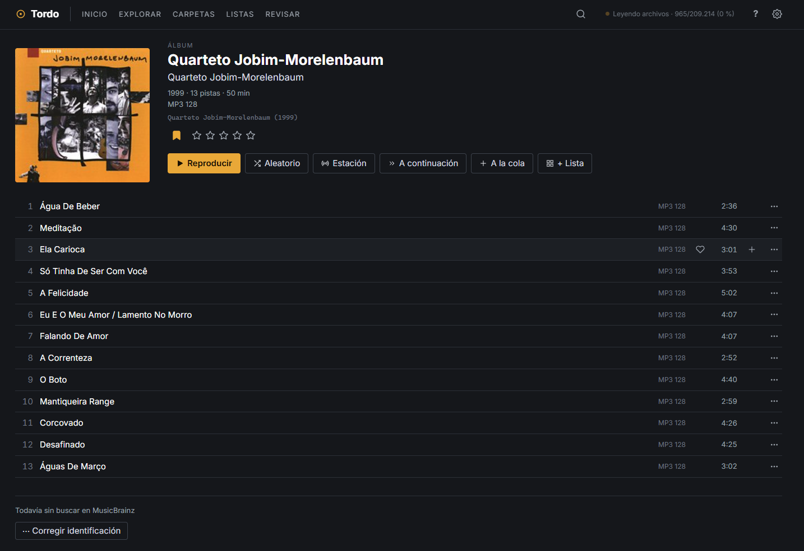

# Tordo

[English](README.md) · [Español](README.es.md) · Português

Um catálogo e player local e portátil para uma coleção de música espalhada por algumas
pastas de um mesmo disco. **Status: M6 (modo Jukebox: usar o computador como alto-falante)** — varredura,
leitura nativa de tags, impressões digitais de áudio, álbuns, pastas e coleções, identificação
automática com MusicBrainz e Discogs, uma API JSON em localhost e a interface web
com player, curtidas, notas, listas de reprodução, contagem de reproduções, estações, Início,
estatísticas de audição, normalização de volume, detecção de duplicados, acesso pela rede com PIN e modo Jukebox
para compartilhar a reprodução entre dispositivos, em três idiomas (espanhol, inglês e
português do Brasil); veja `docs/superpowers/specs/2026-10-01-tordo-design.md` (em espanhol).

- **Somente leitura** na sua música: nunca move, renomeia, altera as tags nem exclui arquivos.
- **Portátil:** um executável por sistema operacional; o catálogo (`tordo.db`) e o
  `config.json` ficam ao lado dele, com caminhos relativos a ele.
- **Local ou LAN:** por padrão roda em `127.0.0.1`; opcionalmente escuta na rede da sua casa (`0.0.0.0`) com autenticação por PIN.

## Capturas de tela

As capturas mostram a interface em espanhol.


<table>
  <tr>
    <td width="50%"><br><sub><b>Início</b>: álbuns adicionados recentemente e suas estações</sub></td>
    <td width="50%"><br><sub><b>Álbum</b>: faixas, formato, nota, reproduzir, aleatório, estação, fila e lista</sub></td>
  </tr>
  <tr>
    <td width="50%"><br><sub><b>Tocando agora</b>: o player em tela cheia</sub></td>
    <td width="50%"><br><sub><b>Pastas</b>: navegue pelas pastas com número de faixas, duração, formato e tamanho</sub></td>
  </tr>
  <tr>
    <td width="50%"><br><sub><b>Status da varredura</b>: cada etapa, o progresso e o tempo restante; os álbuns aparecem enquanto os arquivos são lidos</sub></td>
    <td width="50%"></td>
  </tr>
</table>

## Uso

Coloque a pasta `tordo/` no disco, ao lado das suas pastas de música, e execute o
binário do seu sistema. Na primeira vez, abre Boas-vindas (o assistente) no
navegador, que pede as pastas de música (com `-no-browser` ele não abre; o endereço
está no log). Escolha as pastas, um token do Discogs opcional e a normalização,
depois salve para criar o `config.json` e varrer a biblioteca. Se já existe um `config.json`,
o assistente não aparece. O modo somente leitura (pastas somente leitura ou um binário `tordo`
sem permissão de escrita) mostra no lugar a página de configurações.

```json
{
  "roots": ["../musica", "../musica-ordenar"],
  "ignore": ["Podcasts", "Soulseek/incomplete"],
  "discogsToken": "",
  "normalize": true,
  "listenMode": false,
  "language": "",
  "rescanMinutes": 60,
  "lan": {
    "enabled": false,
    "port": 4747,
    "pinHash": ""
  }
}
```

`listenMode` (padrão `false`) é o modo ouvir: o servidor responde 403 nas rotas
de curadoria (varredura, identificação, coleções, apelidos de gêneros); ele é ativado
em Configurações, somente a partir do computador que executa o Tordo.

`language` escolhe o idioma da interface: `""` (padrão) é automático e acompanha o
idioma do navegador, ou então um entre `"es"`, `"en"` e `"pt-BR"`. Se o idioma do navegador não for
nenhum desses, a interface fica em inglês. O idioma escolhido em Configurações (somente a partir do
computador que executa o Tordo) vale para todos os navegadores que usam esta instalação.

`rescanMinutes` (padrão `60`) é de quanto em quanto tempo as pastas são verificadas em busca de mudanças; `0`
desativa. O máximo é 10080 (uma semana).

`discogsToken` é opcional; sem ele, os gêneros vêm do MusicBrainz, dos seus
links para o Discogs e das tags; obtenha um em https://www.discogs.com/settings/developers.

`normalize` (verdadeiro quando ausente) liga ou desliga a normalização de volume; as mudanças valem
imediatamente em Configurações, sem reiniciar.

`ignore` acrescenta pastas a pular: um nome vale em qualquer lugar, um caminho com `/`
vale a partir da raiz. As pastas de outros aplicativos (Ableton, djay, Audio Music Apps,
`downloading` do Soulseek, bibliotecas do Apple Music) são sempre puladas.
O `ffprobe`, quando está no `PATH`, lê os formatos que os leitores incorporados não
leem (APE, WavPack, AAC bruto…).

### Configurações

A página de configurações permite gerenciar as pastas de música, os padrões a ignorar, de quanto em quanto tempo procurar
mudanças, o token do Discogs, a normalização de volume, o idioma da interface e o acesso pela rede local. Cada configuração mostra o que faz
ao ser alterada: varrer a biblioteca (pastas ou padrões alterados), atualizar
os gêneros (novo token do Discogs) ou valer imediatamente (normalização).

O campo **token do Discogs** verifica o token no endpoint `/oauth/identity` do Discogs
quando você clica em "Verificar"; o servidor o aceita mesmo assim se a verificação
falhar (sem rede). Alterar o token dispara uma atualização da identificação.

A **normalização de volume** pode ser ligada ou desligada na hora, sem reiniciar o Tordo; o
player e os filtros de Explorar são atualizados imediatamente.

As configurações só podem ser alteradas a partir do computador que executa o Tordo. Em outros dispositivos
da rede local aparece a mensagem "As configurações só podem ser alteradas no computador que executa
o Tordo", e você só pode encerrar a sua sessão.

### Explorar e ouvir

Explorar lista álbuns, artistas ou faixas de todo o catálogo, filtrados por
década e ano, artista, país, gênero e estilo, coleção, pasta,
qualidade, formato e estado (não identificado, não reproduzível, com duplicados); também
filtra por Curtidas (♥; chamado Preferidos na aba Álbuns, onde filtra pelo marcador),
Nota (★ N ou mais) e Escuta (nunca ouvido, ou sem ouvir há um ano), e ordena por
Mais ouvido. Os filtros ficam na URL. As páginas de artista mostram seus álbuns por ano e suas
faixas em coletâneas. A pesquisa (Ctrl+K / ⌘K) encontra artistas, álbuns, faixas e
pastas enquanto você digita, ignorando maiúsculas e acentos. Pastas é um explorador de arquivos:
uma árvore de pastas à esquerda (pastas que contêm apenas uma pasta são reunidas em uma
linha, `Soulseek › complete`; filtre por nome, ou aperte `/`, e mova-se com as
setas e Enter) e, à direita, as subpastas da pasta com seu
tamanho relativo e os arquivos que estão diretamente nela, ordenáveis por coluna. No celular
vira uma lista por pasta. Uma pasta detectada por engano como coleção pode ser marcada como
"Não é uma coleção". Abra um álbum
e reproduza, embaralhe uma pasta, coloque faixas na fila. A fila
e o volume ficam guardados no navegador, por dispositivo. MP3, FLAC, AAC, Opus,
Vorbis e WAV tocam como estão, com avanço dentro da faixa; WMA, ALAC, AIFF, APE e
WavPack precisam do `ffmpeg` no `PATH` e são convertidos na hora (os sem perdas para
FLAC, os com perdas para MP3), sem poder avançar. As capas vêm da imagem da pasta do
álbum, das imagens embutidas nos arquivos ou do Cover Art Archive; as miniaturas ficam
em cache em `cache/thumbs/`.

#### Jukebox

Use o computador que executa o Tordo como alto-falante a partir do seu celular ou de outro navegador: abra
Configurações → Reprodução no computador e ative "Usar o áudio deste computador para o Tordo"
(essa opção aparece somente no computador). A barra superior mostra "🔊 Áudio deste computador"
enquanto essa aba tem o áudio. Mantenha essa aba aberta; quando você a recarregar, clique em "Reativar o áudio"
uma vez (os navegadores bloqueiam o som até que a página receba um clique). A configuração de áudio fica lembrada
por aba: quando essa aba é recarregada, ela se reconecta e pede um clique; se outra aba
assumir o áudio, a primeira mostra "Outro navegador assumiu o áudio deste computador."

A partir de um celular ou de outro navegador com acesso à LAN, a barra superior mostra um botão "🎵 Jukebox"
(visível somente enquanto o áudio do computador está ativo). Toque nele para passar o player para o
computador: a barra mostra "Jukebox · no computador" com a faixa, a fila e os
controles do computador; a reprodução do seu celular é pausada e a fila dele é mantida para depois. Não é lembrado
após recarregar.

**Anfitriões e convidados:** O computador que executa o Tordo é sempre
anfitrião. Os outros dispositivos da LAN são convidados por padrão, mas podem ser marcados como
anfitriões em Configurações → Rede local → Dispositivos. Os anfitriões têm controle total: ▶
substitui a fila, pular, avançar, volume, aleatório/repetir, reordenar, limpar e estações.
Os convidados só podem adicionar: ▶ adiciona ao fim da fila e só inicia a reprodução quando
a fila está vazia ou terminou; tocar em uma única música adiciona só essa música; ⤮ adiciona as faixas embaralhadas;
"Para a fila" e "Reproduzir a seguir" funcionam como sempre. Os convidados podem pausar/retomar e remover somente as faixas
que adicionaram. O servidor faz valer esses limites.

#### Curtidas e notas

Marque faixas, artistas e coleções com ♥ (Curtidas; as faixas curtidas são as
*Músicas favoritas*). Marque álbuns com o marcador (*Preferido*): os álbuns são uma lista curta para
voltar a eles, não favoritos. Os álbuns preferidos são guardados como marcas de álbum (`kind: album`
na API). Dê nota a faixas e
álbuns com ★ (1 a 5 estrelas). Essas marcas aparecem nas linhas de faixas (junto de um menu
com nota, "Reproduzir a seguir", "Para a fila" e "Adicionar a uma lista…"), nos cabeçalhos de
álbum, nas páginas de artista, na barra do player, nos cartões de coleção e nas páginas de pasta.
Elas são guardadas por impressão digital de áudio, então acompanham os arquivos que são movidos, renomeados ou
têm as tags alteradas.

#### Contagem de reproduções

Uma reprodução é contada uma vez por passagem quando você ouve pelo menos 4 minutos ou metade da
faixa, o que for menor. Avançar não soma tempo de audição. As
reproduções são registradas com o nome do dispositivo; veja-as em Explorar.

#### Listas de reprodução

Crie uma lista na página Listas ou com "+ Lista" em qualquer álbum, pasta,
artista, coleção, ou no menu ⋯ de uma faixa. Reordene as entradas arrastando
a alça (com mouse ou toque) ou com Alt+↑/↓. Renomeie, exclua a lista ou remova entradas
individuais; as faixas cujos arquivos sumiram continuam na lista como "indisponível" e são
puladas na reprodução. No máximo 5000 entradas por lista.

#### Página Listas

Veja suas listas de reprodução e sua curadoria: Listas de reprodução, Músicas favoritas (faixas ♥, uma
lista automática), Álbuns preferidos (álbuns com marcador, os marcados mais recentemente primeiro),
suas Curtidas (Artistas · Coleções) e suas Coleções.

#### Estações

Uma estação reproduz uma sequência de álbuns ou faixas sorteados de uma fonte, sem repetir
o que acabou de colocar na fila, com regras de variedade para evitar o que foi ouvido há pouco. Sua
fonte é uma destas:
- Uma **consulta de Explorar** com duas visões: `tracks` (as faixas que coincidem) ou `albums`
  (todas as faixas dos álbuns que coincidem; para artistas corresponde à aba Artistas de Explorar).
- Uma **pasta** (recursiva; as coleções também são pastas).
- Uma **lista de reprodução** (as entradas que ainda podem ser reproduzidas).
- **Curtidas** (♥): todas as faixas curtidas, todas as faixas dos álbuns curtidos, todas as faixas dos
  artistas curtidos e todas as faixas das coleções curtidas (um álbum Preferido com marcador conta como um
  álbum curtido).

Os **modos** são `tracks` (faixa por faixa) ou `albums` (álbuns inteiros de cada vez; uma única
faixa conta como um álbum de uma faixa).

**Regras** (com seus valores padrão):
- `artistGap` (0–20, padrão 3): nenhum artista de novo dentro das últimas N faixas.
- `avoidDays` (0–365, padrão 7): pular as faixas reproduzidas nos últimos N dias (um álbum:
  qualquer uma de suas faixas).
- A estação nunca repete uma faixa que já colocou na fila (o navegador envia até as
  últimas 100 reproduzidas).

Quando nenhuma faixa cumpre todas as regras, elas são **afrouxadas uma de cada vez** nesta ordem: intervalo entre artistas,
dias a evitar, já colocada na fila (mas nunca a que acabou de tocar, se houver outra).
O lote fica vazio (e a estação para) somente quando a fonte não tem nada reproduzível;
caso contrário, com as regras afrouxadas as faixas podem se repetir.

O navegador busca até 10 faixas por vez e pede mais quando restam menos de 3.
A fila guarda somente as últimas 100 faixas reproduzidas, então a estação nunca
fica sem música. As estações salvas são guardadas por nome e ficam em Suas estações, no Início.

**Pesos** (para sortear as faixas):
- Base: 1.
- ×3 quando a faixa ou o álbum dela tem ♥.
- ×2 quando o artista dela tem ♥.
- × {1: 0.25, 2: 0.5, 3: 1, 4: 2, 5: 3} conforme a maior nota (★) entre a da faixa e a do álbum.

#### Início

A primeira página, que mostra:
- Linhas fixas: **Adicionados recentemente** (os álbuns mais novos), **Suas estações** (as
  estações salvas, mais duas embutidas: "Toda a coleção" e "Suas curtidas" quando há algo
  curtido), **Continuar ouvindo** (álbuns pela última reprodução), **Suas músicas favoritas**
  (álbuns com faixas ♥, pela última curtida) e **Álbuns preferidos**
  (álbuns com marcador, os mais recentes primeiro).
- **Três linhas rotativas**, sorteadas com uma semente a partir das facetas do catálogo (década,
  país, gênero, estilo, coleções, álbuns nunca ouvidos, álbuns sem ouvir há um ano,
  álbuns aleatórios). A maioria das linhas precisa de pelo menos 4 álbuns para ser sorteada; a de álbuns aleatórios
  precisa de apenas 1. As linhas com poucos itens ficam ocultas.

O botão ↻ sorteia uma nova semente e refaz as linhas rotativas; cada nova visita sorteia uma nova
semente. Somente as recargas depois de uma varredura ou de uma identificação mantêm a mesma semente. Cada linha leva
a Explorar com o seu filtro e (exceto as linhas fixas não curadas) tem um botão ▶ para iniciar
a sua estação.

#### Histórico de audição (estatísticas)

Seu histórico de audição por período: **Última semana** (7 dias), **Último mês** (30 dias), **Último ano**
(365 dias), **Sempre**. Rankings das faixas, álbuns, artistas,
países e gêneros mais reproduzidos; totais (reproduções, tempo ouvido, faixas distintas); e
contagens de **álbuns** nunca ouvidos e sem ouvir há um ano em todo o catálogo (com link para
Explorar).

Uma reprodução é atribuída a **uma** faixa: o arquivo de onde foi reproduzida, se estiver presente
com o mesmo áudio; senão, o arquivo presente de menor número com esse áudio. Cada
gênero de um álbum conta como uma reprodução.

#### Faceta Escuta

Filtre álbuns ou faixas por `listened`: **never** (nunca ouvido) ou **year-ago**
(ouvido, mas a última reprodução tem mais de 365 dias). Um álbum só é nunca ouvido
se nenhuma de suas faixas foi reproduzida.

#### Páginas de artista

Mostram as 5 faixas mais reproduzidas do artista (de todos os tempos) acima dos álbuns dele.

As URLs, os parâmetros de consulta, os nomes de facetas e os caminhos da API estão em inglês, seja qual for o idioma
da interface (`/explore`, `/folders`, `/settings`, `/help`…; `?view=albums&order=year`,
`decade`, `listened=never`…).

| Método e caminho | O que devolve |
|---|---|
| `GET /api/status` | progresso da varredura, contagens do catálogo (as últimas conhecidas quando o catálogo está ocupado; nenhuma antes do primeiro), `preparing` enquanto o primeiro catálogo é montado, estado da normalização, indicador `setupPending`, `language` |
| `POST /api/scan` | inicia uma varredura (`Content-Type: application/json`) |
| `GET /api/albums?folder=` | álbuns, todos ou dentro de uma pasta |
| `GET /api/albums/{id}` | um álbum com suas faixas (com `sizeBytes` por faixa), versões (outros álbuns que compartilham grupos de duplicados) e dados técnicos |
| `GET /api/folders?path=` | uma pasta: subpastas (com tamanho), álbuns, faixas soltas e os arquivos que estão diretamente nela (sem `path`: as raízes) |
| `GET /api/folders/tree?path=` | um nível da árvore de Pastas: subpastas, com as cadeias de passagem reunidas |
| `GET /api/folders/tree/search?q=` | pastas por nome, com as linhas da árvore que levam a elas |
| `GET /api/collections` | pastas detectadas como coleções, com seus álbuns em ordem |
| `PUT /api/folders/collection` | `{"path", "collection": false}`: não é uma coleção (`true` a restaura) |
| `GET /api/explore?view=&<facets>&order=&dir=&from=&limit=` | uma página de Explorar (álbuns, artistas ou faixas) com as contagens das facetas |
| `GET /api/artists/{key}` | um artista: álbuns por ano, aparições em álbuns de outros e suas 5 faixas mais reproduzidas em `top` |
| `GET /api/search?q=&limit=` | artistas, álbuns, faixas e pastas que coincidem com `q` |
| `GET /api/genres` | a taxonomia de gêneros e estilos |
| `GET /api/genres/unmapped` | gêneros brutos das tags que nenhum mapeamento conhece (Gêneros para mapear) |
| `PUT /api/genres/aliases`, `DELETE /api/genres/aliases?raw=` | mapear um gênero bruto (ou ignorá-lo), ou esquecer o mapeamento |
| `GET /api/review/unidentified` | álbuns aguardando revisão de identificação |
| `PUT /api/albums/{id}/identification` | escolher a identificação de um álbum (`DELETE` volta à automática) |
| `GET /api/review/duplicates?kind=` | grupos de duplicados; `kind` é `exact`, `formats` ou `suspected` (padrão `exact` se ausente ou desconhecido); devolve `{counts, recoverable, groups}` |
| `GET /api/review/formats` | faixas que precisam de conversão, por formato |
| `GET /api/marks` | curtidas e notas de faixas e álbuns (por id), e artistas e coleções curtidos |
| `PUT /api/likes` | marcar ou desmarcar uma curtida (♥) (`{kind, id|key, liked}`; `kind` é track/album/artist/collection; `album` é o marcador Preferido) |
| `PUT /api/ratings` | definir ou apagar a nota de uma faixa ou álbum (`{kind, id, stars}`; `stars` 0–5, 0 apaga) |
| `POST /api/plays` | registrar uma reprodução de uma faixa (`{id, listenedMs, device}`); ignorado no modo somente leitura |
| `GET /api/liked` | as faixas curtidas (♥), os álbuns preferidos (marcador), os artistas e coleções curtidos, os mais recentes primeiro |
| `GET /api/gains?track=` | os ganhos de cada faixa em dB (`{id: {trackGain, albumGain}}`, das tags ReplayGain ou do volume medido); as faixas ainda não medidas vão primeiro na fila de análise; as faixas marcadas como "não mensuráveis" (sem tag ReplayGain e com a medição falhando de forma permanente) não são analisadas de novo |
| `GET /api/playlists` | as listas de reprodução do usuário |
| `POST /api/playlists` | criar uma nova lista de reprodução |
| `GET /api/playlists/{id}` | as entradas de uma lista |
| `PUT /api/playlists/{id}` | renomear uma lista |
| `DELETE /api/playlists/{id}` | excluir uma lista |
| `POST /api/playlists/{id}/items` | adicionar uma entrada a uma lista |
| `DELETE /api/playlists/{id}/items/{item}` | remover uma entrada |
| `PUT /api/playlists/{id}/order` | reordenar as entradas |
| `GET /api/stations` | estações salvas, as atualizadas mais recentemente primeiro |
| `POST /api/stations` | salvar uma estação (corpo: `{name, source, mode, artistGap, avoidDays}`) |
| `PUT /api/stations/{id}` | renomear ou atualizar uma estação |
| `DELETE /api/stations/{id}` | excluir uma estação salva |
| `GET /api/station/next?def=<JSON>&recent=1,2,3` | o próximo lote de faixas da estação (pelo menos 10 faixas, possivelmente mais no modo álbuns para incluir álbuns completos), com mime e ganhos; `recent` é uma lista separada por vírgulas de até 200 ids de faixas reproduzidas há pouco; a resposta inclui `station` (a definição da estação como o servidor a aplicou) |
| `GET /api/home?seed=N` | Início: linhas fixas, linhas rotativas e estações salvas; `seed` sorteia as linhas rotativas, se ausente ou inválida usa-se uma aleatória |
| `GET /api/stats?period=&limit=` | Histórico de audição: `period` é `week`/`month`/`year`/`all` (padrão `month`); `limit` é o tamanho de cada ranking (padrão 10, faixa 1–100) |
| `GET /api/play?album=&folder=&artist=&track=&shuffle=1&playlist=&liked=1` | as faixas a colocar na fila, em ordem (no máximo 5000) |
| `GET /stream/{trackId}` | o áudio de uma faixa (`Range` para avançar; `?transcode=1` a converte) |
| `GET /api/covers/album/{id}?size=` | a imagem de um álbum, inteira ou como miniatura de 160/320/640 px |
| `GET /api/covers/track/{id}?size=` | a imagem embutida no arquivo de uma faixa |
| `GET /api/config` | a configuração atual (as configurações só podem ser lidas a partir do computador local) |
| `PUT /api/config` | salvar a configuração: raízes, padrões a ignorar, intervalo de verificação, token do Discogs, normalização, idioma, configurações da LAN (somente a partir do computador local) |
| `POST /api/config/root` | verificar se uma pasta pode ser uma raiz: devolve o caminho canônico ou um erro |
| `POST /api/config/token` | verificar se o Discogs aceita um token: devolve `{valid: true/false/null}` (null sem conexão) |
| `GET /api/lan` | informações da LAN: ativada, porta, escutando e as URLs para outros dispositivos chegarem ao Tordo |
| `GET /api/lan/qr?url=` | código QR em SVG de uma URL |
| `GET /api/auth` | sempre 200: `{local, session, device, pinRequired, language}` (a página mostra a tela do PIN quando `pinRequired` é verdadeiro; os demais caminhos `/api/` e `/stream/` respondem 401 sem sessão) |
| `POST /api/auth/login` | autenticar-se com o PIN a partir de um dispositivo da LAN: `{pin, device}` |
| `POST /api/auth/logout` | encerrar esta sessão |
| `GET /api/sessions` | listar as sessões ativas (somente a partir do computador local) |
| `DELETE /api/sessions/{id}` | encerrar uma sessão por id (somente a partir do computador local; os dispositivos da LAN só podem encerrar a própria sessão com `POST /api/auth/logout`) |

Os erros são JSON, `{"code", "message", "params"}`, com o mesmo status HTTP de sempre: `message` está em
inglês e `code` é um identificador estável (declarado em `internal/server/codes.go`) que o aplicativo web
traduz.

## Como funcionam a varredura e a identificação

A ajuda do aplicativo (Ajuda → *Como funciona: varredura e identificação*) tem uma versão em linguagem simples desta seção.

### Quando uma varredura roda

Ao iniciar, sempre que as pastas de música ou os padrões a ignorar mudam em Configurações, com
`POST /api/scan` e a cada hora (`rescanMinutes`, contada a partir do fim da última varredura).
A varredura inicial espera os álbuns aparecerem na tela: primeiro é mostrado o catálogo salvo,
e percorrer as pastas ao mesmo tempo deixaria mais lenta a leitura dele quando ambos estão no
mesmo disco.

A rodada programada percorre as pastas e compara tamanhos e datas de modificação com o
catálogo, sem abrir nenhum arquivo e escrevendo somente as linhas que diferem. Sem diferenças e
sem nada esperando para ser lido, ela termina aí: o status não muda, os álbuns não são
remontados, a identificação não roda e as páginas não são recarregadas. Caso contrário, segue como uma varredura normal e passa a aparecer na barra superior. Ela roda também no modo ouvir, como a
varredura inicial: esse modo bloqueia o que as pessoas pedem, não manter o catálogo em dia. Um
disco externo em repouso acorda a cada rodada, então um intervalo maior ou `0` evita isso.

As varreduras são **incrementais**: somente os arquivos novos e os que mudaram de tamanho ou de
data de modificação são lidos de novo (também todos os arquivos depois de uma atualização que muda
o leitor, e os arquivos que falharam quando o `ffprobe` aparece no `PATH`). A barra superior mostra a
etapa: `Procurando arquivos · n`, `Lendo arquivos · n/m (p%)`, `Montando álbuns`; durante a leitura, o catálogo é reagrupado a cada 30 s, então os álbuns
aparecem em Início e Explorar conforme a varredura avança (as páginas são recarregadas sozinhas). A varredura
nunca usa a rede.

### 1. Percorrer (`internal/scan`)

Cada raiz é percorrida e cada arquivo catalogado é registrado com seu tamanho e data de modificação:
áudio (`.mp3 .flac .m4a .aac .opus .ogg .oga .wma .wav .aif(f/c) .ape .wv`),
imagens (`.jpg .jpeg .png .webp`), letras (`.lrc`) e listas de reprodução (`.m3u .m3u8`).
As pastas ignoradas (`ignore` no `config.json`, mais as pastas de outros aplicativos) são puladas.

Os dados ausentes são tratados com cautela:
- uma raiz que não está disponível (disco desconectado) é pulada e o catálogo dela é mantido;
- uma raiz que desaparece no meio da varredura aborta a varredura sem marcar nada como ausente;
- uma raiz percorrida com erros de leitura é mantida, mas seus arquivos não vistos não são marcados como ausentes;
- os arquivos que não são mais vistos em uma raiz percorrida sem problemas são marcados como **ausentes**, não excluídos
  do catálogo, então voltam como estavam quando o disco retorna.

### 2. Ler (`internal/audiofile`, `internal/fingerprint`)

De cada arquivo de áudio pendente, o Tordo lê as tags (título, artistas, álbum, artista do álbum,
números de faixa e de disco, ano, gêneros, indicador de coletânea, ids do MusicBrainz, capa embutida),
os dados técnicos (formato, codec, duração, taxa de bits, taxa de amostragem, profundidade de bits, canais,
ReplayGain) e calcula uma **impressão digital de áudio**: SHA-256 dos primeiros e dos últimos
64 KiB dos dados de áudio mais o tamanho, sem as tags nem as imagens embutidas
(nem os cabeçalhos de página do Ogg). Mover, renomear ou alterar as tags de um arquivo mantém a impressão digital;
as cópias idênticas bit a bit compartilham uma. Os leitores nativos cuidam dos formatos comuns; o `ffprobe`
cobre o resto. Os resultados são gravados em lotes de 100, então uma varredura interrompida mantém
o que fez. Os erros de entrada/saída são tentados de novo na próxima varredura; os arquivos lidos mas não compreendidos são
guardados com o erro.

### 3. Agrupar (`internal/grouping`)

Depois da leitura, os álbuns, faixas, pastas e coleções são remontados a partir de todo o
catálogo (uma função pura dos dados guardados, igual a cada execução). Um resultado igual ao
guardado (o hash dele fica em `grouping_stamp`) não grava nada, então uma varredura de uma
biblioteca sem mudanças deixa o catálogo e os títulos identificados como estavam:

- Os **campos da faixa** vêm das tags e, se faltarem, do nome do arquivo
  (`01 - Artista - Título.mp3`) e do nome da pasta (`Artista - Álbum (1985)`).
  Os nomes de sites de download e os códigos de arquivo são descartados das tags.
- Os **álbuns** são identificados por pasta + título de álbum normalizado. As pastas de disco (`CD1`,
  `Disc 2`) se juntam ao álbum da pasta-mãe. Em uma pasta cujas tags não coincidem, os grupos de uma
  ou duas faixas soltas se juntam ao álbum principal da pasta quando ele tem dois terços das
  faixas; uma pasta formada em sua maioria por álbuns de uma ou duas faixas vira uma única
  **seleção** com o nome da pasta. As faixas sem tag de álbum em uma pasta com
  pelo menos duas faixas recebem o nome de álbum da pasta; as demais são faixas soltas.
- **Artista do álbum:** a tag de artista do álbum; *Vários artistas* para tags, pastas
  ou vários artistas de faixa do tipo "Various"; senão, o artista da pasta, o único artista
  de faixa, ou a pasta-mãe quando ela tem o nome de um artista conhecido.
- **Capa:** uma imagem chamada `cover`, `folder` ou `front`; depois uma cujo nome
  as mencione; depois a maior imagem nas pastas do álbum (também `Scans/`,
  `Artwork/` abaixo); as imagens `back…` nunca contam. Uma capa embutida também é mantida.
- **Coleções:** pastas com pelo menos 3 álbuns em pastas-filhas de pelo menos 2
  artistas de álbum, com um nome que não é o de um artista.

Quando a varredura termina (a menos que seja cancelada), ela dispara a identificação e, com o `ffmpeg`,
a medição de volume.

### 4. Identificar (`internal/identify`)

O processo de identificação trabalha álbum por álbum no MusicBrainz, uma consulta por
segundo como o MusicBrainz pede; uma primeira passada sobre ~10.000 álbuns leva algumas horas e
continua de onde parou. A barra superior mostra `Identificando · n/m`.

1. **Primeiro os ids das tags.** Se a maioria das faixas tem o mesmo id de álbum do MusicBrainz
   e o MusicBrainz o conhece, o álbum é identificado com confiança 1.
2. **Busca.** Caso contrário, são buscadas em ordem até quatro variantes de consulta: o
   título e artista agrupados, o título e artista da pasta, e ambos sem marcas de disco nem
   notas entre parênteses (`(Remastered)`). As coletâneas buscam Various Artists.
3. **Pontuação.** Cada candidato recebe uma confiança de 0 a 1:

   | Sinal | Peso | Regra |
   |---|---|---|
   | Título | 0.30 | similaridade (1 − distância de edição / tamanho, depois de normalizar) |
   | Durações das faixas | 0.25 | proporção de faixas a menos de 3 s de uma faixa do lançamento (por posição quando as quantidades coincidem) |
   | Artista | 0.20 | similaridade com o crédito ou com qualquer um dos nomes creditados |
   | Número de faixas | 0.15 | igual é o melhor; menos faixas que o lançamento recebem uma parte; mais recebem 0 |
   | Ano | 0.10 | exato (do lançamento ou primeiro lançamento) 1, ±1 metade; sem ano, uma metade neutra |

   Os resultados da busca não trazem durações, então somente os que ainda poderiam alcançar o limite
   são consultados por completo (no máximo 4 consultas por álbum).
4. **Decidir.** Com **0.80** ou mais, o álbum é identificado automaticamente. Caso contrário,
   vai para Revisar → *Não identificados* com seus cinco melhores candidatos.

As correspondências são guardadas em cache pela sua consulta (variantes, ano, id da tag e durações
arredondadas): um álbum só é buscado de novo quando o que o descreve muda, ou quando
o comparador melhora.

### 5. Completar e aplicar

Para cada lançamento em uso, o Tordo busca o artista principal (para o seu **país**), os **gêneros
e estilos** do Discogs (pelos links do MusicBrainz para o Discogs, os do lançamento ou os do
seu grupo, com o master como alternativa; com um `discogsToken`, também uma busca no Discogs)
e uma **capa** do Cover Art Archive (do lançamento ou, senão, do grupo de lançamentos) para os álbuns
cuja pasta não tem nenhuma, guardada em `cache/covers/`. A barra mostra
`Completando dados · n/m` e depois `Em dia`.

Em seguida, *aplicar* recalcula a identidade de cada álbum somente com os dados guardados (sem consultas):
o título do álbum, o artista, o ano original e o país do MusicBrainz; os títulos das faixas alinhados por
posição (ou pelo título mais parecido) quando as durações coincidem em até 3 s; os gêneros do Discogs,
senão os do MusicBrainz, senão os das tags. Os gêneros brutos das tags que nenhum mapeamento conhece vão para Revisar →
*Gêneros para mapear*. Nada é gravado nos arquivos de áudio.

### Correções e sem conexão

Escolher um candidato, colar um lançamento do musicbrainz.org, ou marcar um álbum como não estando no
MusicBrainz (em *Não identificados* ou em *Corrigir identificação* na página do álbum) é
guardado por **impressão digital da faixa**: sobrevive a mover, renomear e alterar as tags, vale
quando pelo menos metade das faixas de um álbum a tem, e a identificação automática nunca
a sobrescreve. Sem rede, o processo mostra `Sem conexão com o MusicBrainz` e
tenta de novo sozinho (após 5 minutos, dobrando até uma hora); todo o resto continua funcionando.

### Revisar

#### Duplicados

O Tordo detecta três tipos de grupos de duplicados; nunca exclui arquivos, só os lista.

1. **Cópias idênticas:** dois ou mais arquivos com áudio idêntico (a mesma impressão digital de áudio). Os bytes recuperáveis de um grupo são todos os seus arquivos menos o maior.
   Os grupos são ordenados por bytes recuperáveis, do maior para o menor.

2. **Mesma música em vários formatos:** faixas do mesmo álbum com o mesmo id de gravação do MusicBrainz, ou com o mesmo artista e título normalizados e duração dentro de 2 segundos (encadeadas por duração); um grupo precisa de pelo menos duas impressões digitais de áudio distintas (os arquivos idênticos bit a bit são somente cópias idênticas). Os arquivos são ordenados por qualidade (sem perdas > com perdas; os sem perdas por profundidade de bits e depois taxa de amostragem; os com perdas por taxa de bits) e depois por caminho. O melhor arquivo recebe um selo MELHOR quando é estritamente melhor que todos os outros do seu grupo.

3. **Suspeitas (mesmo artista e título em álbuns diferentes):** o mesmo artista, título e duração (dentro de 2 segundos) em álbuns diferentes, com pelo menos duas impressões digitais de áudio distintas. Ordenadas por artista e depois por título. Somente informativo. O melhor arquivo de cada grupo recebe um selo MELHOR quando é estritamente melhor que todos os outros.

Um álbum é marcado como "Com duplicados" (filtro Estado em Explorar) quando uma ou mais de suas faixas pertencem a um grupo de duplicados de cópias idênticas ou de formatos.

#### Formatos para converter

Detecta quais faixas usam formatos que precisam de conversão para tocar: WMA, WAV, AIFF, APE, WavPack e ALAC.
Mostra totais (arquivos, bytes) e um item por álbum × formato (ou pasta × formato para as faixas soltas),
ordenados por tamanho. **Somente detecção:** nada é convertido automaticamente.

#### Versões de um álbum

A página do álbum lista os outros álbuns que compartilham com ele um ou mais grupos de duplicados de cópias idênticas ou de formatos:
seu título, artista, ano, os formatos das faixas compartilhadas, quantas faixas deste álbum eles compartilham
e o tipo de grupo (`exact` quando todas as faixas compartilhadas são cópias idênticas, senão `formats`).

## Normalização de volume

O Tordo normaliza o volume de toda a sua coleção para −18 LUFS (EBU R128).
Primeiro olha as tags ReplayGain; se faltarem, o `ffmpeg` mede o
volume em segundo plano (primeiro as faixas mais novas), e o áudio que está
prestes a tocar passa na frente da fila. As faixas ainda não medidas tocam a −6 dB. A
normalização só abaixa o volume, nunca aumenta. O ganho de álbum é aplicado quando
um álbum é reproduzido em ordem (aleatório desligado). Ative ou desative em Configurações; o player
pega isso de `/api/status` sem reiniciar.

## Acesso pela rede

Por padrão, o Tordo só escuta em `127.0.0.1` (o computador que o executa). Em Configurações
você pode ativar **Rede local** para permitir que outros dispositivos da sua rede doméstica o acessem.

### Ativar o acesso pela LAN

Quando você ativa "Usar o Tordo em outros dispositivos da rede", o Tordo pede para
você escolher um PIN de 6 a 12 dígitos. O PIN é escolhido ao ativar a LAN; um PIN digitado enquanto a LAN
está desativada não é salvo. Depois o Tordo escuta em `0.0.0.0` na porta 4747 (padrão; altere em
Configurações se for preciso).

A conexão é HTTP simples, sem criptografia: é segura em uma rede doméstica. Use somente
em casa, não pela internet.

### Autenticação por PIN

O PIN protege o acesso a partir de outros dispositivos da LAN. Depois de 5 tentativas erradas, cada
tentativa errada adicional bloqueia os acessos por 30 segundos (dobrando a cada vez, até 1 hora);
um PIN correto zera o bloqueio. Enquanto está bloqueado, o servidor responde 429 com `Retry-After`.

Alterar o PIN encerra a sessão de todos os dispositivos (eles precisam entrar de novo).

### Sessões

Quando você entra a partir de um dispositivo, o servidor cria uma sessão de 90 dias (um cookie `tordo_sesion`,
`HttpOnly`, `SameSite=Lax`, sem criptografia). Se você não usar um dispositivo por um dia, a
sessão é estendida automaticamente por mais 90 dias na sua próxima requisição. As sessões com mais
de 90 dias são excluídas no próximo acesso.

Em Configurações, você pode ver a lista de sessões ativas (uma linha por dispositivo com o nome dele
e a data do último uso) e encerrar qualquer uma a partir desse dispositivo.

### Endereços da LAN e QR

Configurações mostra os endereços onde você pode chegar ao Tordo na sua rede doméstica: `http://<ip>:<porta>/`
para cada endereço IPv4 local, e depois `http://<nome-do-computador>.local:<porta>/`. Cada endereço tem um código
QR que você pode escanear com o celular para abri-lo.

A tela do PIN aparece quando você carrega a página em um dispositivo não local (celular, tablet, outro
computador da LAN). Depois de entrar, tudo o que você pode fazer no computador principal funciona:
reproduzir, explorar, dar nota, curtir, montar listas de reprodução, estações e ver suas estatísticas. A única coisa
que você não pode fazer a partir de outro dispositivo é alterar as configurações; isso só é possível a partir do
computador que executa o Tordo.

### Configuração: o bloco lan

```json
"lan": {
  "enabled": false,
  "port": 4747,
  "pinHash": ""
}
```

- `enabled`: se o ouvinte da LAN está em execução.
- `port`: a porta em que escutar (1024–65535); 0 ou ausente significa a porta padrão, 4747.
- `pinHash`: o PIN com hash (PBKDF2-SHA256, 100.000 iterações). Vazio até que um PIN seja escolhido; ativar a LAN exige um. Alterar o PIN encerra a sessão de todos os dispositivos.

## Desenvolvimento

O aplicativo web (Svelte 5 + Vite, em `web/`) é embutido no binário a partir de
`internal/server/dist/`, que não é versionado: compile-o antes de `go run` ou
`go build`, ou o navegador mostra uma página pedindo isso.

```bash
go test ./...                       # full suite, no network
(cd web && npm ci && npm test && npm run build)   # web app tests and build
go run ./cmd/tordo -dir .run        # config and catalog in .run/
bash scripts/build.sh               # web app, then binaries in dist/tordo/
TORDO_CORPUS=/path/to/music go test ./internal/audiofile -run Corpus -v -timeout 0
```

Para publicar uma versão, envie uma tag de versão (`git tag v1.0.0 && git push origin v1.0.0`):
o workflow `release` roda os testes e o `scripts/build.sh`, e anexa os binários
e o `SHA256SUMS.txt` ao release do GitHub dessa tag.
