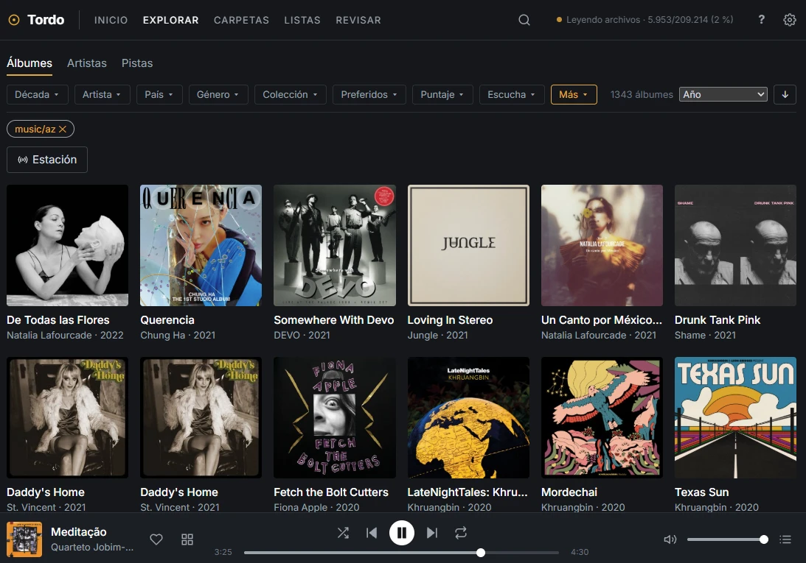
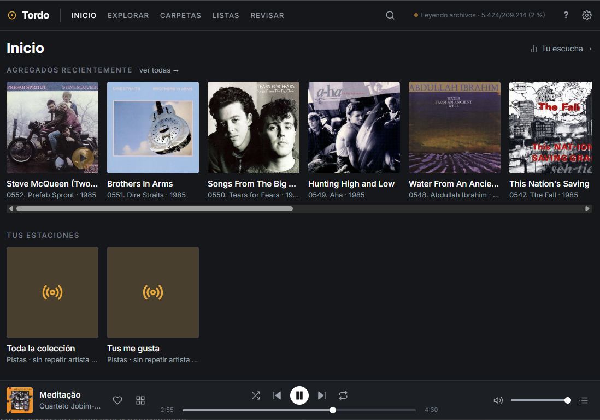
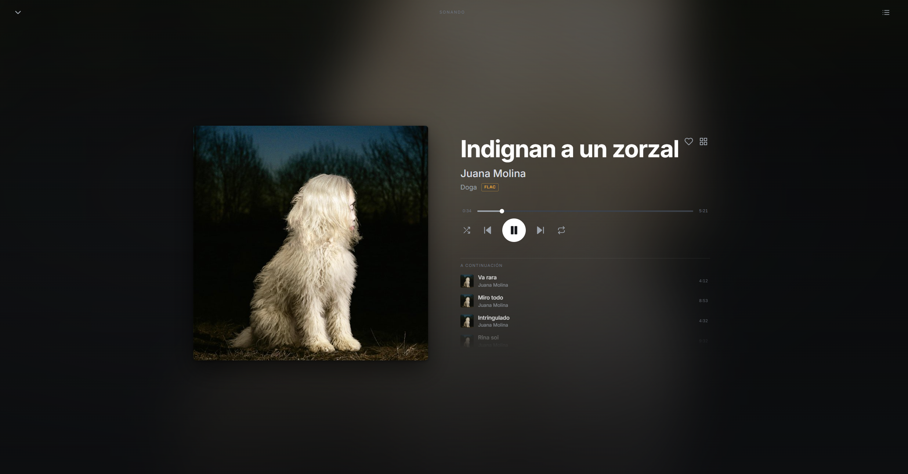
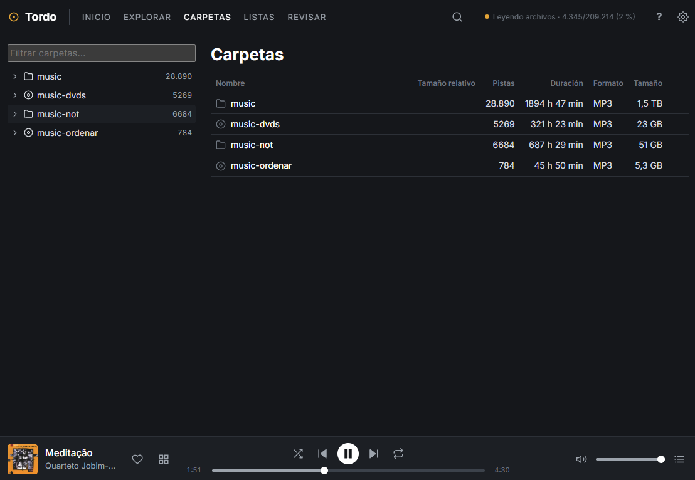

# Tordo

[English](README.md) · [Español](README.es.md) · Português

**Sua coleção de música, organizada e para ouvir em qualquer navegador da sua casa.**
Mostre ao Tordo as pastas onde está a sua música: ele cataloga cada álbum, reconhece os
álbuns na internet e deixa você navegar e ouvir no computador, no celular ou no tablet.

- **Seus arquivos continuam como estão.** O Tordo só lê a sua música: nunca move, renomeia,
  reetiqueta nem apaga nada.
- **Um só arquivo, nada para instalar.** O Tordo guarda o catálogo na própria pasta, então
  você pode levá-lo num disco para outro computador.
- **Privado.** Roda no seu computador e na rede da sua casa, sem conta e sem nuvem.

## Primeiros passos

1. **Baixe** o arquivo para o seu computador na
   [versão mais recente](https://github.com/martjanz/tordo/releases/latest):
   **Windows** `tordo-windows.exe` · **Mac** `tordo-macos.zip` · **Linux**
   `tordo-linux-amd64.zip` (`tordo-linux-arm64.zip` num Raspberry Pi).
2. **Coloque o Tordo ao lado das suas pastas de música** (no mesmo disco, se a sua música
   estiver num disco externo):
   - **Mac e Linux:** clique duas vezes no zip para obter uma pasta `tordo`, e mova essa pasta.
   - **Windows:** crie uma pasta chamada `tordo` e mova o arquivo baixado para ela.
3. **Clique duas vezes no arquivo `tordo` dessa pasta.** O Tordo abre no navegador.
   Na primeira vez, o computador pode pedir permissão para abri-lo: veja
   [Se o computador bloquear](#se-o-computador-bloquear).
4. **Escolha as suas pastas de música** e clique em **Começar**. Os álbuns aparecem enquanto
   o Tordo os lê.

Pronto. Da próxima vez, é só clicar duas vezes no arquivo de novo. Enquanto o Tordo está
aberto fica uma janelinha com texto; feche-a para fechar o Tordo.

Para ouvir no celular, abra **Configurações → Rede local** no computador. Para qualquer
outra dúvida, aperte **?** no Tordo.

### Se o computador bloquear

O Tordo não é distribuído por uma loja de aplicativos, então na primeira vez é preciso um
passo a mais:

- **Windows:** quando aparecer *O Windows protegeu o computador*, clique em **Mais
  informações** e depois em **Executar assim mesmo**.
- **Mac:** quando o Mac disser que não consegue verificar o Tordo, clique em **OK**, abra
  **Ajustes do Sistema → Privacidade e Segurança**, role até o fim, clique em **Abrir Mesmo
  Assim** e clique duas vezes no arquivo de novo.
- **Linux:** se o clique duplo abrir o arquivo num editor de texto, clique com o botão
  direito e escolha **Executar como programa** (ou **Executar**).

## O que você pode fazer

- **Navegar** por álbum, artista, faixa ou pasta, com filtros por década, país, gênero,
  estilo, formato, qualidade e mais. A busca encontra qualquer coisa enquanto você digita
  (Ctrl+K ou ⌘K).
- **Ter os dados certos:** os álbuns são reconhecidos no [MusicBrainz](https://musicbrainz.org)
  (e, se quiser, no [Discogs](https://www.discogs.com)) para ter títulos, anos, países,
  gêneros e capas corretos, sem mexer nos seus arquivos.
- **Ouvir** álbuns, pastas e listas, no aleatório, ou começar uma **estação** sem fim a partir
  de um artista, um gênero, uma pasta ou dos seus favoritos.
- **Marcar** músicas com ♥, salvar álbuns para voltar a eles e dar notas com ★.
- **Ouvir num volume uniforme** entre álbuns (normalização de volume).
- **Ver o seu histórico de audição:** as músicas, álbuns, artistas e gêneros mais ouvidos.
- **Organizar:** encontrar duplicados e arquivos em formatos que o navegador não toca. O
  Tordo só os mostra, nunca apaga.
- **Ouvir em qualquer dispositivo** da rede da sua casa, protegido por um PIN.
- **Jukebox:** tocar nas caixas de som do computador e deixar todo mundo adicionar músicas
  pelo celular.
- **No seu idioma:** espanhol, inglês ou português do Brasil.

<table>
  <tr>
    <td width="50%"> <b>Início</b>: álbuns adicionados recentemente e suas estações</td>
    <td width="50%"> <b>Álbum</b>: faixas, formato, nota, reproduzir, aleatório, estação, fila e lista</td>
  </tr>
  <tr>
    <td width="50%"> <b>Tocando agora</b>: o player em tela cheia</td>
    <td width="50%"> <b>Pastas</b>: as suas pastas com número de faixas, duração, formato e tamanho</td>
  </tr>
</table>

As capturas mostram a interface em espanhol.

## Bom saber

- **A primeira varredura demora um pouco.** Ler uma coleção grande leva minutos, e
  reconhecê-la na internet, mais: algumas horas para 10.000 álbuns na primeira vez. Enquanto
  isso você pode ouvir, e se fechar o Tordo ele continua de onde parou.
- **Funciona sem internet.** Só o reconhecimento on-line precisa dela; ele espera e tenta de
  novo sozinho.
- **Extras opcionais:**
  - O [ffmpeg](https://ffmpeg.org/download.html) permite ao Tordo tocar arquivos WMA, ALAC,
    AIFF, APE e WavPack, e igualar o volume de músicas sem tags ReplayGain.
  - Um [token do Discogs](https://www.discogs.com/settings/developers) gratuito, colado em
    Configurações, dá gêneros e estilos mais precisos.
- **Só na rede da sua casa.** O acesso por outros dispositivos é HTTP sem criptografia: tudo
  bem em casa, não para a internet.
- **As configurações são alteradas no computador que roda o Tordo**, não em outros
  dispositivos.

## Para usuários avançados

A configuração (`config.json`), as opções de linha de comando, o detalhe de cada função,
como funcionam a varredura e a identificação, a API HTTP e como compilar o Tordo estão na
[versão em inglês](README.md#for-advanced-users) e em [docs/](docs/how-it-works.md) (em
inglês). O [design](docs/superpowers/specs/2026-10-01-tordo-design.md) está em espanhol.
